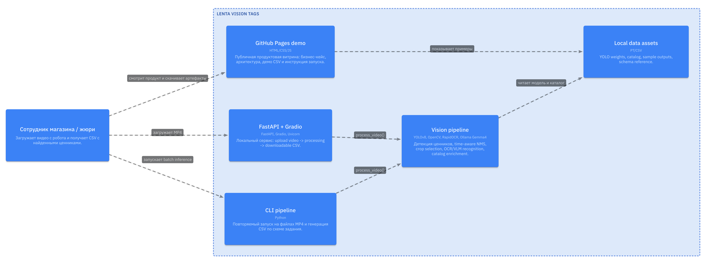
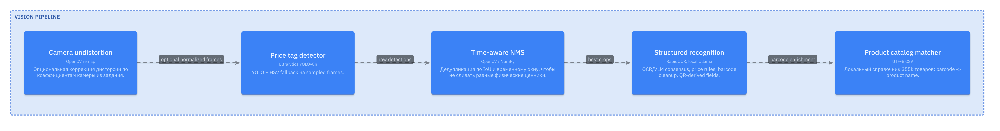

# О!Собрано — поездка, в которой всё сходится

Прототип трека Островка «О!дин запрос»: свободный запрос → уточнение → сравнение целых поездок → проверка времени и бюджета → пересборка → явно имитированный заказ.

**Модели:** только `opencode/deepseek-v4.1-flash-free` и `opencode/glm-5.3-flash-free` через официальный OpenCode CLI 2.1.4. Платные модели запрещены конфигурацией адаптера. На 24.10.2026 оба реальных вызова из среды разработки получили HTTP 403, несмотря на использование официального CLI. Поэтому доступность живого AI проверяется отдельно и не подменяется зелёным тестом parser. Подробности: [FREE_MODELS.md](docs/ostrovok/FREE_MODELS.md).

**Данные:** настоящие открытые координаты городов, справочник аэропортов и историческая погода. Отели, тарифы, рейсы/поезда и наличие — синтетический демонстрационный инвентарь. Реальных покупок и списаний нет. [Источники, лицензии, границы](docs/ostrovok/DATA_SOURCES.md).

## Запуск за одну команду

Требуются Git, Docker Desktop или Docker Engine с Compose. GPU и API-ключи не нужны.

```bash
git clone https://github.com/MakSoS1/lenta_tech.git
cd lenta_tech
git checkout feat/ostrovok-free-agent-2026-10-24
cp .env.example .env
docker compose up --build
```

Открыть **http://localhost:8080**. Приложение и API обслуживаются одним непривилегированным контейнером; `/health` проверяет готовность. Compose публикует `8080:8080`; архитектура `linux/amd64` задана явно. На Apple Silicon используется эмуляция, время холодного запуска может отличаться.

При доступном бесплатном OpenCode используется модель. При отказе сервиса интерфейс показывает **ограниченный режим** и причину; parser и формы продолжают работать. Он не выдаётся за полноценное понимание произвольных запросов. Для полностью воспроизводимого запуска без обращений к LLM:

```bash
LLM_MODE=offline docker compose up --build
```

Другая бесплатная модель выбирается в `.env`:

```dotenv
OPENCODE_MODEL=opencode/glm-5.3-flash-free
```

Ключи платных провайдеров, OpenCode balance и подписки адаптеру не передаются. При недоступности бесплатного сервиса приложение не покупает доступ и не переключается на платный ID.

## Что попробовать

> Из Москвы в Анталью 7 ноября 2026 на неделю, двое взрослых и ребёнок 7 лет. До 180 тысяч рублей.

Затем: «С нами собака 8 кг», «На два дня позже», «Добавь завтрак». Можно выбрать перелёт и сказать «Оставь перелёт»; конфликтующее изменение потребует явного снятия фиксации. Выберите вариант, обновите котировку, подтвердите состав и сумму, получите `DEMO-…`. Перезагрузка и повтор запроса сохраняют один заказ.

Поддерживаемое окно демоданных: **01.11.2026–31.01.2027**, 2–14 ночей. Отправление из Москвы и Санкт-Петербурга. Направления: Казань, Сочи, Калининград, Санкт-Петербург, Ереван, Стамбул, Анталья, Хургада. Покрытие каталога не утверждает наличие настоящих рейсов. Выход за покрытие объясняется пользователю.

Для неизвестных parser формулировок доступны поля условий. Относительные даты привязаны к текущему времени, а в тестах часы фиксированы. Возраст ребёнка и вес питомца не угадываются. Цены целочисленные, на всю группу, с обоими переездами и трансферами.

## Что реализовано

- Три сравнимых варианта, состав цены, временная шкала, причины и компромиссы.
- Программные проверки совместимости; ночной заезд требует подходящих условий и оплаченной ночи.
- Версии поездки, частичные изменения, сохранение ограничений, фиксация транспорта и отображение изменений.
- SQLite/WAL, отдельные сессии, защита от устаревших команд, котировки и атомарное оформление с идемпотентностью.
- Мобильный интерфейс, история сессии, opt-in предпочтения, демонстрационный запрос раннего заезда после покупки.
- Изолированный процесс OpenCode без инструментов, доступа к проекту и платным credentials.

Имитированный заказ не подтверждает реальное место в самолёте/поезде или номер. Запрос раннего заезда имеет статус «запрошено», а не подтверждение отеля. Историческая температура — средняя суточная по выборке 2021–2025, не прогноз и не температура моря.

## Тесты и воспроизводимость

Python-зависимости зафиксированы в `pyproject.toml`, `uv.lock` и экспортированных lock-файлах с хешами. Frontend и OpenCode имеют `package-lock.json`.

```bash
python3 -m venv .venv
.venv/bin/pip install --require-hashes -r apps/ostrovok/backend/requirements-dev.lock
.venv/bin/python -m pytest apps/ostrovok/tests -q
.venv/bin/python apps/ostrovok/scripts/validate_snapshot.py
.venv/bin/python apps/ostrovok/evals/run.py --report reports/ostrovok/offline-eval.json
npm ci --prefix apps/ostrovok/frontend
npm test --prefix apps/ostrovok/frontend
npm run build --prefix apps/ostrovok/frontend
```

**Ostrovok application CI** проверяет домен/API, данные, UI, холодный Docker-запуск, полный HTTP-путь, desktop/mobile Playwright и сохранность заказа после перезапуска контейнера. Артефакты содержат отчёты, снимки и видео.

**Ostrovok free model live checks** отдельно вызывает обе бесплатные модели через официальный CLI и пробует полный AI-путь. Недоступность inference даёт ненулевой exit code и отчёт `blocked`, а не успешный тест AI.

40 функциональных сценариев limited-parser проверяются отдельно от LLM. Их результат нельзя называть качеством DeepSeek или GLM. Независимый holdout и сравнительный benchmark моделей требуют работающего inference и ещё не доказаны.

## Обновление открытых данных

```bash
python apps/ostrovok/scripts/fetch_open_data.py
python apps/ostrovok/scripts/validate_snapshot.py
```

Скачивание выполняется во временное место, затем данные проверяются и заменяют snapshot. Ошибка сохраняет предыдущую версию. Manifest хранит URL, дату, размер, лицензию и SHA-256 каждого исходного ответа. Данные Open-Meteo — CC BY 4.0; бесплатный hosted API предназначен для некоммерческого использования. Для коммерческого запуска нужны соответствующие условия доступа. OurAirports — public domain. Необязательная выборка Wikidata содержит исторические отели и не участвует в выдаче тарифов.

## Документы проекта

- [Первоначальный подробный план](docs/ostrovok/OSTROVOK_HACKATHON_PLAN_2026-10-23.md).
- [Контракты приложения](docs/ostrovok/IMPLEMENTATION_CONTRACT.md).
- [Бесплатные модели: конфигурация и реальные проверки](docs/ostrovok/FREE_MODELS.md).
- [Источники данных и лицензии](docs/ostrovok/DATA_SOURCES.md).

Локальные данные лежат в Docker volume `trip-data`. `docker compose down` сохраняет их. Секреты и реальные персональные документы для демо не нужны. Тег `submission` относится к финальной согласованной сдаче и не создаётся автоматически при разработке.

---

<details>
<summary>Исходный проект репозитория: Lenta Vision Tags</summary>

# Lenta Vision Tags

Локальное решение для хакатона **Lenta Tech Life Hack**: робот снимает полку на видео, система находит ценники, извлекает поля и возвращает CSV в схеме задания.

[Демо на GitHub Pages](https://maksos1.github.io/lenta_tech/) · [Research graph](https://maksos1.github.io/lenta_tech/knowledge.html) · [Архитектура](docs/architecture/workspace.c4) · [Примеры CSV](outputs_unlabeled_final)

## Почему это бизнес-решение

В ритейле ошибка на ценнике быстро превращается в спор на кассе, ручную проверку и потерю доверия. Lenta Vision Tags закрывает регулярный контур контроля:

- робот проходит вдоль полки и снимает видео;
- CV-модель находит уникальные ценники во времени, а не только на одном кадре;
- OCR/VLM и локальный справочник товаров превращают визуальный сигнал в structured data;
- результат можно сравнить с мастер-данными: цена, промо, barcode, SKU, дата печати, цвет ценника.

Решение работает **локально**, без облачных API. Это важно для магазинов: видео полки и ассортиментные данные остаются внутри контура.

## Что внутри



Pipeline:

1. **Frame sampling**: равномерный отбор кадров из MP4.
2. **Camera preprocessing**: опциональный undistort по коэффициентам камеры из доп. материалов.
3. **Detection**: YOLOv8 + HSV fallback.
4. **Time-aware NMS**: дедупликация с учетом IoU и времени, чтобы не сливать разные физические ценники в одной зоне кадра.
5. **Best crop selection**: выбор самого резкого кропа через Laplacian variance.
6. **Structured recognition**: RapidOCR, локальный Ollama VLM, правила цен и нормализация CSV.
7. **Catalog enrichment**: локальный каталог `355835` товаров, barcode -> product name.
8. **CSV contract**: порядок и названия колонок совместимы с `sample.csv`.



## Research graph

Исследовательские заметки из Obsidian сохранены в [`docs/knowledge`](docs/knowledge): raw vault, нормализованный `graph.json`, презентационный обзор и интерактивная страница сайта `site/knowledge.html`.

Это удобно использовать в защите: можно показать, какие гипотезы проверялись, почему часть подходов была отброшена и как решение пришло к локальному edge-пайплайну.

## Режимы работы

`general` — честный production fallback для неизвестного видео. Использует detector/OCR/VLM/catalog без копирования GT.

`register` — режим для повторных проходов похожих полок. Переносит стабильные поля из локального шаблона и уточняет bbox/timestamp детектором на новом видео. Это полезно для unlabeled-видео с тем же маршрутом робота.

`catalog` — compatibility alias. Для пяти размеченных train-видео он намеренно не возвращает GT-строки, чтобы локальная метрика не превращалась в переобучение.

## Local Run

### 1) Подготовить окружение

Рекомендуем `python3.12` или `python3.13`. На части macOS-конфигураций `python3.14` может ломаться на `ensurepip/pyexpat`.

```bash
python3.12 -m venv .venv
source .venv/bin/activate
pip install -r requirements.txt
```

### 2) Запустить пайплайн из CLI

```bash
python run_pipeline.py path/to/video.mp4 --mode general --output-dir outputs
```

С локальным VLM:

```bash
ollama pull gemma4
python run_pipeline.py path/to/video.mp4 --mode general --vlm-max-tags 20
```

### 3) Запустить API/UI (то, что будет использовать жюри)

```bash
python run_api.py
```

Открыть `http://localhost:7860`, загрузить MP4 и скачать CSV.

### 4) API smoke-test без UI

```bash
curl -s http://127.0.0.1:7860/api/health
curl -s -F "file=@/path/to/video.mp4" http://127.0.0.1:7860/api/process
```

Проверено локально: `2026-05-19` API обработал `/Users/maksos/Downloads/0325.mp4`, вернул `count=40`, CSV сохранен в `outputs/result_7725662e.csv`.

## Данные и артефакты

- `models/price_tag_yolo.pt` — локальные веса детектора.
- `data/catalog/products.csv` — нормализованный UTF-8 справочник товаров из `db_hack.csv` (`cp1251` в исходнике).
- `docs/task_requirements.pdf` и `docs/sample_contract.csv` — исходное задание и эталонный CSV-контракт.
- `src/preprocessing/camera_undistort.py` — реализация undistort по коэффициентам камеры.
- `outputs_unlabeled_final/*.csv` — финальные CSV для unlabeled-видео.
- `docs/honest_general20_metrics_20260518.txt` — честная валидация `general` без GT-copy.

## Честная оценка качества

После удаления leakage через GT:

- `general --no-vlm`, 5 размеченных видео, 20 sampled frames:
  - detection: `229/274 = 0.836`;
  - official metric: `0/274 = 0.000`.

Это не прячется: QR на видео практически не декодируется, barcode и мелкая зачеркнутая цена часто физически нечитаемы, а локальный VLM медленный и нестабилен. Поэтому финальная продуктовая стратегия разделена:

- **general** для новых неизвестных полок как честный baseline;
- **register** для повторных проходов магазина, где стабильные поля можно переносить из локальной базы и подтверждать актуальными bbox/timestamp.

## Проверка CSV

```bash
python validate.py --all --pred-dir outputs_honest_general20
```

Быстрые тесты репозитория:

```bash
python -m unittest discover -s tests -v
```

Для unlabeled-артефактов:

```bash
python run_pipeline.py data/Данные/Unlabeled/25_12-20.mp4 --mode register --output-dir outputs_unlabeled_final
```

## Структура

```text
src/
  api/                  FastAPI + Gradio
  catalog/              local product catalog lookup
  detection/            YOLO + HSV detector
  pipeline/             main PriceTagPipeline
  preprocessing/        camera undistortion
  qr/                   QR utilities
data/catalog/           normalized product catalog
docs/architecture/      LikeC4 DSL
docs/assets/            rendered architecture screenshots
docs/knowledge/         Obsidian research graph and raw notes
site/                   GitHub Pages product demo
outputs_unlabeled_final sample submission CSVs
```

## Deploy

GitHub Pages публикует статический сайт из папки `site/` через workflow `.github/workflows/pages.yml`.

Локальный backend не разворачивается в Pages по требованиям задачи: модель и видео должны оставаться в локальном контуре.

</details>
