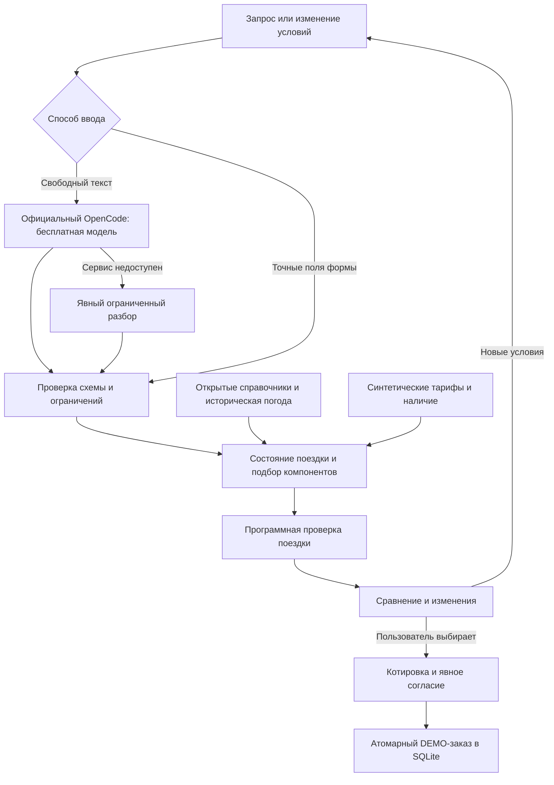
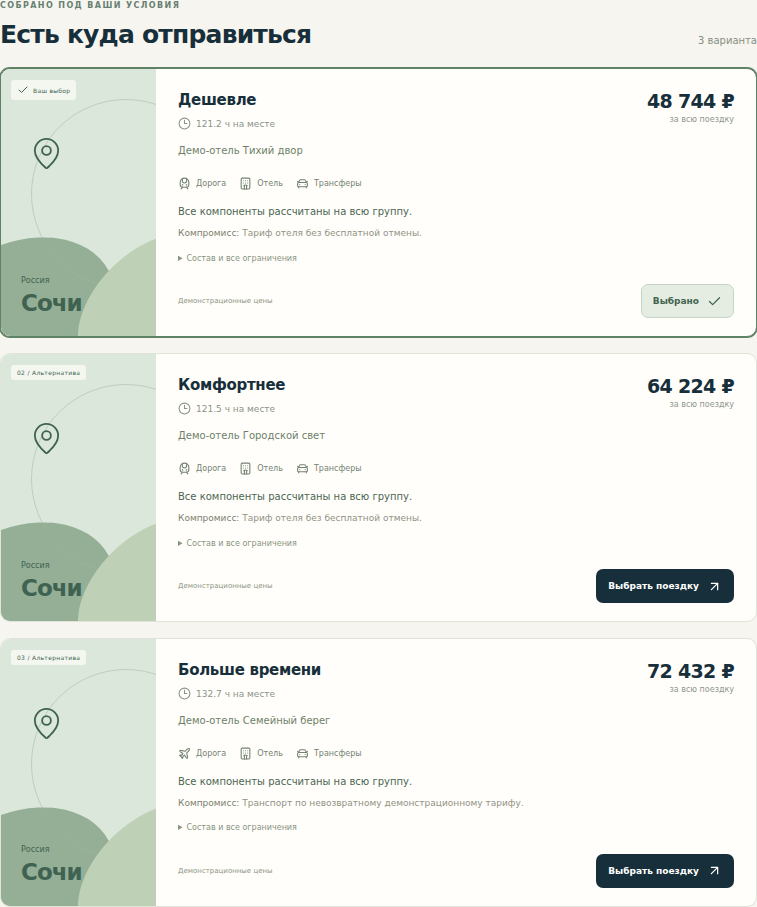

# О!Собрано: реализация на бесплатных моделях и проверка пайплайна

**Дата проверки:** 24 октября 2026 года.

**Репозиторий:** [MakSoS1/lenta_tech](https://github.com/MakSoS1/lenta_tech).

**Ветка:** [feat/ostrovok-free-agent-2026-10-24](https://github.com/MakSoS1/lenta_tech/tree/feat/ostrovok-free-agent-2026-10-24).

**Pull request:** [#2](https://github.com/MakSoS1/lenta_tech/pull/2); draft отражает незакрытую проверку живой модели.

## 1. Результат и существенное ограничение

Реализован запускаемый прототип «О!Собрано»: запрос о поездке, уточнения, подбор и сравнение целых вариантов, объяснение компромиссов, изменение условий, проверка котировки, явное согласие и имитированный заказ. Есть адаптивный интерфейс, серверное состояние, история, предпочтения и демонстрационный запрос раннего заселения. Открытые справочные данные действительно скачаны, сохранены с происхождением и используются приложением.

Архитектура переведена на **бесплатные `opencode/deepseek-v4.1-flash-free` и `opencode/glm-5.3-flash-free` через официальный OpenCode CLI 2.1.4**. Платного резервного провайдера нет. Исходный план сохранён как исследовательский документ; эта реализация и контракт имеют приоритет в части нового требования о бесплатных моделях.

**Успешный живой AI-пайплайн пока не подтверждён.** Реальные вызовы обеих моделей из среды разработки получили HTTP 403 `FreeTierError` даже через официальный CLI. Отдельные реальные проверки в GitHub Actions также завершились `blocked / free_model_unavailable`. Это внешний блокер, а не успешная генерация. Причина отказа внутри официального клиента не установлена; нет доказательств, что покупка подписки или получение ключа решит проблему.

В такой ситуации интерфейс явно включает **ограниченный режим без LLM**: правила разбора русского запроса и редактируемые поля условий. Этот режим позволяет проверить бизнес-логику целиком, но не доказывает качество DeepSeek/GLM на произвольных незнакомых запросах жюри. Живые модельные проверки имеют ненулевой код завершения; они не маскируются зелёными тестами правил.

## 2. Что получилось по заданию Островка

| Требование | Реализованное поведение | Где проверяется |
|---|---|---|
| Понять запрос и уточнить необходимое | Типизированные условия, частичные изменения, вопросы об обязательных неизвестных параметрах; возраст ребёнка и вес питомца не угадываются | Тесты intent, pipeline, функциональный корпус |
| Вдохновение без выбранного города | Выбор из покрываемых направлений с ценой всей группы, временем на месте и историческим погодным контекстом | Доменный подбор и API |
| Сравнить поездки | Три варианта с транспортом туда и обратно, полным проживанием и трансферами в обе стороны | API и desktop/mobile Playwright |
| Объяснить выбор | Причины соответствия, компромиссы, состав суммы, условия компонентов и проверки времени | Карточки, корзина и таймлайн |
| Довести до покупки | Выбор → котировка с ограниченным сроком → согласие с точной суммой → один демонстрационный заказ | Checkout-тесты, реальный HTTP smoke, браузер |
| Пересобрать после изменения | Версии состояния, частичный patch, сохранение остальных требований, фиксация транспорта, отчёт об изменениях | Domain/pipeline и браузер |
| Действия после покупки | Явно имитированный запрос раннего заезда, без обещания подтверждения отелем | Серверный API и UI |
| Память | История поездок и заказов в SQLite; сохранение предпочтений по явному выбору пользователя | Session-тесты и перезагрузка страницы |
| Метрики | Отдельные функциональные тесты, 40 сценариев, browser/HTTP проверки и реальные модельные проверки | GitHub Actions и JSON-отчёты |
| Мобильный интерфейс | Адаптивная версия, проверенная при ширине 390 px | Playwright |

«Готовый сценарий» здесь означает корректно собранный **демонстрационный** пакет. Приложение не связывается с настоящим отелем, не резервирует места и не списывает деньги.

## 3. Почему архитектура подходит бесплатным моделям

Модель отвечает за извлечение частичного изменения условий. Сумму, даты, совместимость и оформление определяет приложение. Поэтому нестабильность свободного текста не превращается в произвольное изменение корзины или покупку без согласия.



У адаптера разрешены только два точных бесплатных идентификатора. GLM может быть единственным резервом при временном сбое DeepSeek; на отказ доступа, ограничение частоты, некорректный ответ или исчерпание времени автоматические попытки прекращаются. Платные идентификаторы отклоняются до запуска процесса.

OpenCode запускается в отдельном временном окружении с запрещёнными инструментами. Модели не передаются права на сессию, котировку или заказ. JSON-ответ проходит строгую проверку схемы. Суммы считаются целыми копейками, версия и согласие проверяются на сервере, повтор оформления защищён ключом идемпотентности.

Стек: Python 3.12, FastAPI, Pydantic, SQLite/WAL; React, TypeScript и Vite; официальный OpenCode CLI; pytest/Hypothesis, Vitest и Playwright; Docker Compose и GitHub Actions. Версии Python-пакетов и хеши закреплены в lock-файлах, npm-зависимости устанавливаются через `npm ci`.

Точное назначение параметров и границы адаптера: [FREE_MODELS.md](FREE_MODELS.md). Схемы HTTP и состояния: [IMPLEMENTATION_CONTRACT.md](IMPLEMENTATION_CONTRACT.md).

## 4. Данные, которые действительно получены

В репозитории сохранены **15 исходных ответов общим объёмом 908 511 байт**. Для них есть URL, время получения, HTTP-статус, размер, лицензия и SHA-256. Валидатор проверяет исходные хеши и соответствие нормализованных данных источникам.

| Источник | Фактически сохранено | Использование и граница достоверности |
|---|---:|---|
| Open-Meteo Geocoding / GeoNames | 9 городов | Координаты, страна, часовой пояс и идентификаторы; это справочник мест |
| Open-Meteo Historical Weather API, ERA5 | 16 434 дневные строки за 2021–2025 годы | 9 городов × 1 826 дат; агрегированы в 108 записей «город × месяц» |
| OurAirports | 4 исходных CSV по RU/AM/TR/EG, выборка 12 аэропортов | Справочные коды и координаты; не доказательство существования рейса или расписания |
| Wikidata | 16 сущностей отелей в 6 городах | Исследовательская выборка, включающая исторические здания; не участвует в продаже или формировании тарифов |

Погодные числа — **историческая средняя температура воздуха и осадки**. Они не называются прогнозом на дату поездки, температурой моря или климатической нормой за 30 лет. География и время помогают проверить план; они не дают права заявлять о реальном наличии билетов.

Реальные справочные сведения отделены от демонстрационного инвентаря. Названия предлагаемых демоотелей вымышленные. Стоимость, наличие, условия возврата, разрешение на животных, расписания транспорта и трансферов синтетические и обозначены в UI. Полученные из Wikidata реальные отели не получают придуманных цен.

### Воспроизведение получения данных

```bash
python apps/ostrovok/scripts/fetch_open_data.py --output /tmp/ostrovok-reference
python apps/ostrovok/scripts/validate_snapshot.py --output /tmp/ostrovok-reference

# Дополнительная исследовательская выборка, не обязательная для работы приложения:
python apps/ostrovok/scripts/fetch_hotel_pois.py --output /tmp/ostrovok-reference
```

Новая выборка сначала загружается во временное место и проверяется. Ошибка источника или валидации сохраняет прежний набор. Запросы ограничены временем и размером ответа. Приложение запускается с проверенным снимком и не зависит от доступности справочных API при каждом открытии страницы.

Open-Meteo публикует данные под CC BY 4.0; атрибуция указана рядом с погодой и в документации. Условия бесплатного hosted API и лицензия данных различаются: бесплатный доступ используется для некоммерческого демо. OurAirports публикует данные как public domain, структурированные данные Wikidata доступны под CC0. Подробные ссылки, схема и ограничения: [DATA_SOURCES.md](DATA_SOURCES.md).

## 5. Что и как проверено

Ниже фиксируются результаты конкретных прогонов, а не обещание общей точности агента.

| Проверка | Подтверждённый результат | Что это доказывает |
|---|---|---|
| Python | **134 passed: 121 тест приложения + 13 тестов исходного проекта** | Домен, intent, сессии, котировки, оформление и ограничения адаптера |
| Функциональный корпус | **40/40**, из них **27** оформленных DEMO-заказов | Сценарии ограниченного разбора, уточнения, отказы и пересборка; D01–D12 дополнительно проверяют смысл извлечённых условий |
| Frontend | **10/10**, TypeScript и production build успешны | Проверенные клиентские операции и сборка |
| Playwright в Docker | **2/2 за 8,4 с**: desktop и mobile 390 px | Реальная страница, API и SQLite; сохранение транспорта и восстановление запроса раннего заезда |
| HTTP в Docker | **passed** | Запрос → изменения → выбор → котировка → согласие → заказ → идемпотентный повтор |
| Перезапуск контейнера | **passed** | Заказ доступен после перезапуска с тем же volume |
| Холодная сборка до healthy | **34 с** на финальном GitHub runner | Результат конкретного прогона; на другом компьютере время может отличаться |
| Официальный CLI внутри контейнера | **`opencode v2.1.4`**, проверка прошла | Исполняемый файл и зависимости работают от непривилегированного пользователя с временными XDG-каталогами |
| Сохранённый снимок данных | **PASS**, 15 исходных ответов | Целостность исходников и производных значений |
| Свежее получение данных в Actions | **PASS**, 14 новых ответов / 896 630 байт | Реальная повторная загрузка основных справочников и погоды в отдельную среду |
| Живая DeepSeek free | **blocked**, `free_model_unavailable`, exit 2 | Запрос действительно сделан; успешный inference не получен |
| Живая GLM free | **blocked**, `free_model_unavailable`, exit 2 | То же, проверено отдельным заданием CI |

Проверенный код приложения: [`bc5720d8`](https://github.com/MakSoS1/lenta_tech/commit/bc5720d8c3773b46067978c6f244a093b590fcd6). [Application CI](https://github.com/MakSoS1/lenta_tech/actions/runs/40124561689) завершён успешно; [проверка обеих бесплатных моделей](https://github.com/MakSoS1/lenta_tech/actions/runs/40124561748) завершилась отказом доступа. [Свежие данные](https://github.com/MakSoS1/lenta_tech/actions/runs/40123913358) получены отдельным workflow на предыдущем срезе; его код и загрузчики после этого не изменялись. Последующий commit этого отчёта добавляет документацию и доказательства, а не меняет проверенный runtime.

Долговременная копия результатов: [машиночитаемая сводка](evidence/verification-2026-10-24.json), [все 40 сценариев](evidence/offline-eval.json), [холодный запуск](evidence/cold-start.json), [HTTP-путь](evidence/http-pipeline.json), [перезапуск](evidence/restart-persistence.json), [версия CLI](evidence/container-opencode-version.txt), [DeepSeek live](evidence/live-deepseek-v4.1-flash-free.json), [GLM live](evidence/live-glm-5.3-flash-free.json).

### Исправления по независимому ревью

Ревью выявило четыре существенных дефекта, которые устранены вместе с регрессиями: слово «поездки» меняло транспорт на поезд; точный ответ не снимал вопрос о дате; неполный ответ модели мог потерять неподдерживаемое направление; ожидание в очереди не входило в общий срок модельного вызова. Проверены также крайние случаи: текст подписи формы не меняет бюджет, дата словами без доступной модели требует уточнения, а модель не придумывает число для запроса «в декабре».

Дополнительно восстановлено отображение сохранённого запроса раннего заезда, исправлены русские подписи условий и проверка CLI в итоговом контейнере. В проверке CI включено распространение ошибок через pipeline; отдельный просмотр журналов выявил и помог исправить попытку CLI писать в read-only домашний каталог. Итоговый smoke действительно вывел версию CLI. Повторное ограниченное ревью приняло все четыре существенных и три небольших исправления. Это оценка проверенного изменения, а не утверждение об отсутствии любых будущих ошибок.


В функциональном корпусе часы закреплены на 24.10.2026. Проверка идёт через настоящий FastAPI и SQLite. Для успешных сценариев выполняются выбор, котировка, подтверждение и загрузка заказа. Отрицательные сценарии проверяют ожидаемый отказ или уточнение, а не считаются неудачей только из-за отсутствия покупки.

Это **developer-visible функциональный набор**, не независимый holdout и не сравнение качества двух моделей. Время выполнения этого набора исключает сеть и LLM; его нельзя представлять как пользовательскую задержку AI. Тесты адаптера с управляемыми локальными исполняемыми файлами проверяют ошибки, схему, ограничения и отмену процессов, но не способность внешней модели понять запрос.

### Обязательные для доверия случаи

- Неподдерживаемое направление не заменяется незаметно другим.
- Изменение бюджета или числа ночей сохраняет остальные условия.
- Неизвестные возраст ребёнка и вес питомца требуют уточнения.
- В расчёт входят все гости, оба переезда, проживание и оба трансфера.
- Прилёт, трансфер, заселение, выселение и возврат сравниваются с учётом часовых поясов.
- Условия возврата проверяются для транспорта, отеля и трансфера.
- Устаревшая версия, истёкшая котировка и несовпадающая сумма не оформляются.
- Повтор того же подтверждения возвращает прежний заказ.
- Чужая сессия не получает поездку или заказ по известному идентификатору.
- Отказ модели явно отражается в ответе и интерфейсе.

## 6. GitHub Actions

**Ostrovok application CI** устанавливает закреплённые зависимости, проверяет данные, Python и UI, собирает Docker-образ с нуля, проверяет пользователя контейнера, `/health`, реальный HTTP-путь, desktop/mobile браузер и сохранение заказа после перезапуска. Отчёты, снимки, видео и журнал контейнера сохраняются как artifacts.

**Ostrovok free model live checks** независимо запускает обе бесплатные модели через официальный CLI и пытается выполнить создание поездки, изменение условий и оформление. Если модель не использовалась, задача заканчивается `blocked` и ненулевым exit code. Успех резервного parser не меняет этот результат.

**Ostrovok fresh public reference data** действительно выполнил загрузку в GitHub Actions: 14 исходных ответов, 9 городов, 16 434 дневные погодные строки, 108 месячных агрегатов и 12 аэропортов. Валидация прошла. Необязательная Wikidata-выборка в этот core refresh не входит; она уже отдельно получена и сохранена в исходном снимке. Workflow доступен для ручного запуска и срабатывает при изменениях загрузчиков; результат сохраняется в artifact, а проверенный снимок приложения не заменяется автоматически. [Выполненный запуск](https://github.com/MakSoS1/lenta_tech/actions/runs/40123913358).

CI не получает платных ключей и не создаёт реальных бронирований. Артефакты Actions хранятся 14 дней; долговременные исходные данные и исходный код находятся в ветке репозитория.

## 7. Запуск и сценарий демонстрации

```bash
git clone --branch feat/ostrovok-free-agent-2026-10-24 https://github.com/MakSoS1/lenta_tech.git
cd lenta_tech
cp .env.example .env
docker compose up --build
```

Открыть **http://localhost:8080**. Внутренний и внешний порты — 8080. Образ многоэтапный, процесс работает от пользователя `10001`, состояние хранится в volume `trip-data`. Есть healthcheck. Для Apple Silicon явно выбрана `linux/amd64`; скорость под эмуляцией может отличаться от GitHub runner.

Полностью воспроизводимый запуск без сетевого обращения к моделям:

```bash
LLM_MODE=offline docker compose up --build
```

Выбор бесплатной GLM в `.env`:

```dotenv
LLM_MODE=opencode
OPENCODE_MODEL=opencode/glm-5.3-flash-free
```

Пример запроса для проверки продукта:

> Из Москвы в Анталью 7 ноября 2026 на 7 ночей, двое взрослых и ребёнок 7 лет, до 180 тысяч рублей.

Последовательность демонстрации:

1. Показать сравнение целых пакетов, состав стоимости и источник погодных данных.
2. Сказать: «С нами собака 8 кг»; показать изменения и сохранённые условия.
3. Сказать: «На два дня позже»; показать новый таймлайн.
4. Изменить число ночей через форму; убедиться, что транспорт и направление сохранены.
5. Выбрать вариант, проверить котировку и явно подтвердить сумму.
6. Получить DEMO-заказ, перезагрузить страницу и открыть его из истории.
7. Запросить ранний заезд и пояснить, что это локальная имитация обращения.

На защите следует показать реальный статус модели. Если inference недоступен, назвать режим ограниченным и предъявить модельный CI-отчёт. Нельзя выдавать заранее сохранённые ответы или результаты правил за успешную работу бесплатной LLM.

### Снимки и запись проверенного интерфейса



[Мобильный экран подтверждённого демозаказа](demo/mobile-receipt.png) · [Запись desktop-сценария браузерного теста](demo/desktop-journey.webm).

Это фактические материалы запуска приложения в ограниченном режиме без LLM, а не макеты. Запись показывает технический проход теста; это не пятиминутная презентация для защиты. Цены и покупки демонстрационные.

## 8. Покрытие и оставшиеся условия готовности

Текущий демонстрационный каталог покрывает отправление из **Москвы и Санкт-Петербурга**, восемь направлений: Казань, Сочи, Калининград, Санкт-Петербург, Ереван, Стамбул, Анталья и Хургада. Даты — **01.11.2026–31.01.2027**, 2–14 ночей; фактическое возвращение также должно помещаться в окно. Этот выбор ограничивает объём проверки, а не утверждает доступность реальных маршрутов.

Для полноценной защиты с AI остаётся внешний критерий: получить успешный штатный ответ бесплатной модели в поддерживаемой среде, затем пройти `evals/live.py` до имитированного заказа и запустить независимые незнакомые запросы. Без этого нельзя заявлять качество DeepSeek/GLM или выбор лучшей из них по измерениям.

Для реальных продаж нужны разрешённый поставщиком доступ к наличию и тарифам, повторная проверка цены у поставщика и отдельный контракт бронирования. Открытые справочники и Wiki-сущности не заменяют такие данные. Реальные визовые, пограничные и медицинские рекомендации в этот прототип не включены.

Дополнительные функции большого продукта — мессенджер, сложная миграция постоянного профиля между устройствами, полная система уведомлений, независимое сравнительное исследование моделей — не объявляются реализованными этой поставкой. Мобильный web и текущая сессия с opt-in предпочтениями реализованы. Тег финальной сдачи `submission` и финальная публикация относятся к отдельному выпуску после снятия блокера; автоматическое тестовое видео не заменяет подготовленную защиту.

## 9. Принятые решения

1. **Бесплатный официальный OpenCode вместо платной основной модели.** Это прямое новое требование пользователя. Цена решения: зависимость от доступности и срока бесплатного предложения. При отказе явно показывается ограниченный режим; автоматической оплаты нет.
2. **Явная машина состояний вместо LangGraph для текущего объёма.** SQLite остаётся источником истины, проверки и действия доступны для прямого тестирования. Цена решения: при росте сложных фоновых процессов может потребоваться перенос оркестрации.
3. **Параллельная работа над независимыми модельным, информационным и интерфейсным модулями с общим контрактом.** Это сократило независимую работу; цена решения — риск расхождений на стыках, поэтому выполнены интеграционные проверки и независимое ревью всего изменения.
4. **Сохранить исходное исследование, а реальные справочники отделить от синтетических тарифов.** История выбора остаётся доступна, пользователь видит происхождение сведений. Цена решения: исходный план нужно читать с поправкой этого отчёта, а реальное бронирование требует нового поставщика.

## 10. Файлы и первичные источники

| Назначение | Файл |
|---|---|
| Запуск и пользовательские инструкции | [README](../../README.md) |
| Исходная стратегия, 10 идей и выбранная концепция | [План хакатона](OSTROVOK_HACKATHON_PLAN_2026-10-23.md) |
| Точный контракт приложения | [IMPLEMENTATION_CONTRACT.md](IMPLEMENTATION_CONTRACT.md) |
| Бесплатные модели и реальные ограничения | [FREE_MODELS.md](FREE_MODELS.md) |
| Полученные данные, лицензии, обновление | [DATA_SOURCES.md](DATA_SOURCES.md) |
| Происхождение каждого исходного ответа | [manifest.json](../../apps/ostrovok/data/reference/manifest.json) |
| Корпус сценариев | [cases_dev.jsonl](../../apps/ostrovok/evals/cases_dev.jsonl) |
| Проверка реального модельного пути | [live.py](../../apps/ostrovok/evals/live.py) |

Официальные ссылки проверены 24.10.2026:

- [Каталог моделей OpenCode](https://opencode.ai/v2/docs/console/models/): точные бесплатные ID и временный характер предложения.
- [OpenCode Inference API](https://opencode.ai/v2/docs/console/api/inference/): ограничения бесплатного доступа из других клиентов. Эти правила сами по себе не объясняют полученный отказ внутри официального CLI.
- [Команды официального OpenCode CLI](https://opencode.ai/v2/docs/cli/commands/).
- [Open-Meteo Historical Weather API](https://open-meteo.com/en/docs/historical-weather-api), [лицензия](https://open-meteo.com/en/licence), [условия hosted API](https://open-meteo.com/en/pricing).
- [Открытые данные OurAirports](https://ourairports.com/data/).
- [Лицензирование Wikidata](https://www.wikidata.org/wiki/Wikidata:Licensing).

Вывод о работоспособности конкретного приложения основан на его тестах и журнале GitHub Actions. Документация поставщика подтверждает доступный интерфейс и правила, но не заменяет успешный живой вызов.
